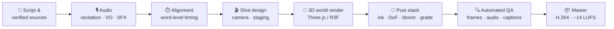

<div align="center">


# Islamic Cinematic Studio

**An AI-directed, code-native animation pipeline for faceless Islamic short-form cinema.**

*Procedural 3D worlds · hand-drawn 2D characters · scripture-verified captions · deterministic frame-accurate rendering*

<br />


<br />

> *"Be in this world as if you were a stranger or a traveler."*
> — Sahih al-Bukhari 6416

</div>

<br />

## ✦ Overview

**Islamic Cinematic Studio** is a programmatic film studio. Every frame is generated from code: no stock footage, no timeline editor, no generative video models. Each film is a React composition rendered frame by frame through a WebGL scene graph. That makes the output **deterministic, versionable and reproducible**: the same commit always renders the same film.

The studio produces 60–90 second vertical films (1080 × 1920, 30 fps) for TikTok, Reels and Shorts, about salah, tawbah, death and the akhirah. The films follow one recurring character, **the Traveller**, a faceless figure moving through cinematic 3D worlds.

Development is **AI-directed**. Scripts, shot design, engine features and quality control are developed together with an AI agent (Claude Code) working directly in this repository. A human reviewer signs off on all religious content before release.

<br />

## ✦ Pipeline



| Stage | What happens |
|---|---|
| **Source** | Quran text is fetched from the quran.com API (Uthmani script + Saheeh International) and stored as raw JSON. Captions are checked against it character by character, so nothing is typed by hand. |
| **Audio** | Recitations, a local neural TTS voice (Kokoro-82M) and procedurally synthesised sound design. Loudness is normalised to −14 LUFS integrated, −1 dBTP. **No music or instruments.** |
| **Alignment** | Local Whisper inference produces word-level timestamps. These are cross-checked against breath and onset detection to place captions and cuts exactly. |
| **World** | Procedural 3D environments (courtyards, cities, interiors, graveyards) built in Three.js through React Three Fiber, with a physically motivated camera rig. |
| **Characters** | The cast is drawn in 2D as vector "cards" in a 600 × 1000 design space. They're billboarded into the 3D scene with lamp-aware shading and walk cycles, and they turn by swapping drawings rather than being squashed. |
| **Post** | A custom shader chain: ink outlines → lens depth of field → bloom → tone mapping → film grade, grain and vignette. |
| **QA** | Scripted checks for frozen and black frames, flicker maps, motion energy, camera pitch limits, collision, caption safe zones and loudness. |

<br />

## ✦ Engine architecture

```
engine/
├── src/
│   ├── draw/          # vector "pen" toolkit for 2D character art
│   ├── characters/    # the Traveller + supporting cast, poses & turnarounds
│   ├── render/        # shaders: ink, card lighting, lens blur, grade
│   ├── camera/        # easing curves, rigs, collision & pitch guards
│   ├── scenes/        # procedural 3D worlds
│   └── toolkit/       # kinetic captions, transitions, tracker UI
├── public/audio/      # local-only audio (git-ignored)
└── remotion.config.ts # Windows/ANGLE-safe render config
```

**Key engineering decisions**

- **2D-in-3D compositing.** The characters keep the warmth of hand-drawn art while the camera moves freely through real 3D space with parallax, depth of field and lighting.
- **Camera guardrails.** A collision solver and a 45° downward-pitch limit stop the flat-card look from showing.
- **Anti-aliasing discipline.** Power-of-two mipmapped textures, anisotropic filtering, z-fighting removal and motion blur give stable, flicker-free frames on phone screens.
- **Memory-bounded rendering.** Renders run in chunks of about 600 frames, one process per chunk, so long films finish reliably on integrated GPUs.

<br />

## ✦ Filmography

| # | Title | Scripture | Length | Status |
|:-:|---|---|:-:|:-:|
| 001 | **The First Question** | Jami' at-Tirmidhi 413 · Surat Maryam 19:59–63 | 1:06 | ✅ Released |
| 002 | **The Last Request** | Surat Al-Munafiqun 63:10–11 | 1:12 | 🎬 Final cut |

<br />

## ✦ Getting started

```bash
cd engine
npm install

npm run studio      # open Remotion Studio (live preview)
npm run typecheck   # strict TypeScript check
npm run stills      # render QA stills / contact sheets
npm run final       # full chunked render of the current film
```

> **Requirements:** Node 18+, Python 3.10+ (audio & QA), Google Chrome. Tested on Windows 11 with integrated Radeon graphics.

<br />

## ✦ Content principles

<table>
<tr><td>🕌</td><td><b>Authenticity first</b>: no invented Quran, hadith or scholarly quotes. Every reference is verifiable, graded where applicable, and listed in each film's <code>references.yaml</code>.</td></tr>
<tr><td>👤</td><td><b>Faceless by design</b>: characters have no facial features. Allah, prophets and angels are never depicted.</td></tr>
<tr><td>🔇</td><td><b>No music</b>: only recitation, voice and natural sound design.</td></tr>
<tr><td>✅</td><td><b>Human sign-off</b>: nothing ships until <code>reviewer.approved: true</code>.</td></tr>
</table>

<br />

## ✦ Credits

- Engine foundation adapted from **[claude-animated-shorts](https://github.com/mromidev/claude-animated-shorts)** by mromidev (MIT).
- Quran text via the **quran.com API**; English translation: **Saheeh International**.
- Voice: **Kokoro-82M** (Apache 2.0). Alignment: **Whisper**.
- Fonts: **Amiri**, **Inter**, **Cormorant Garamond** (SIL Open Font License).
- Third-party audio sources are listed in [`NOTICE.md`](NOTICE.md).

<br />

<div align="center">

<sub>Built frame by frame, for the road home.</sub>

<sub>MIT © Islamic Cinematic Studio</sub>

</div>
